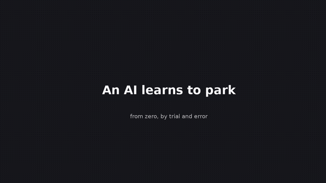
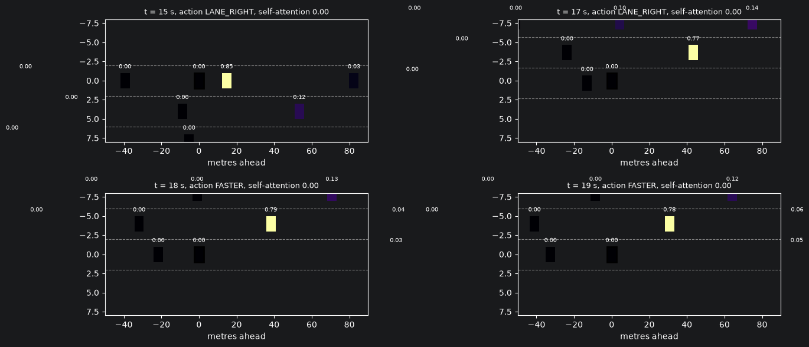
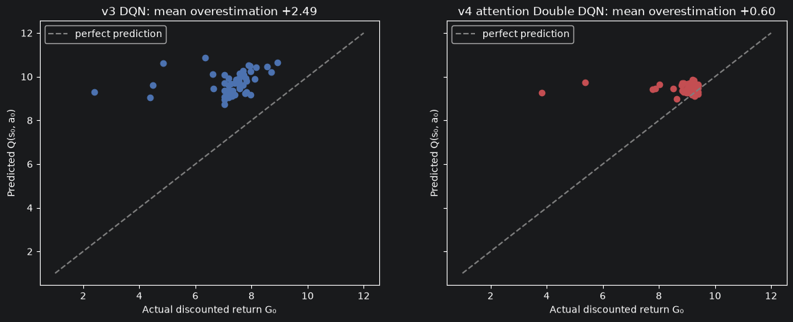
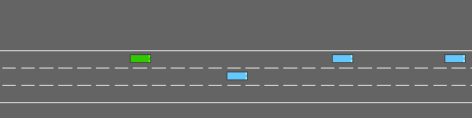
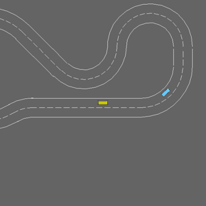
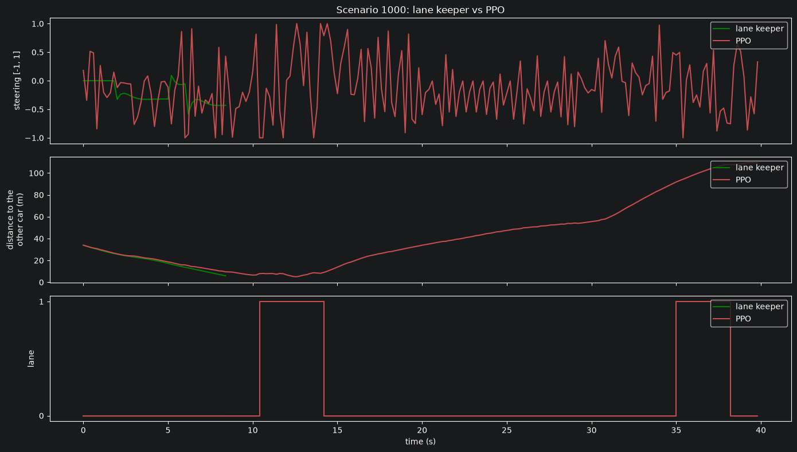
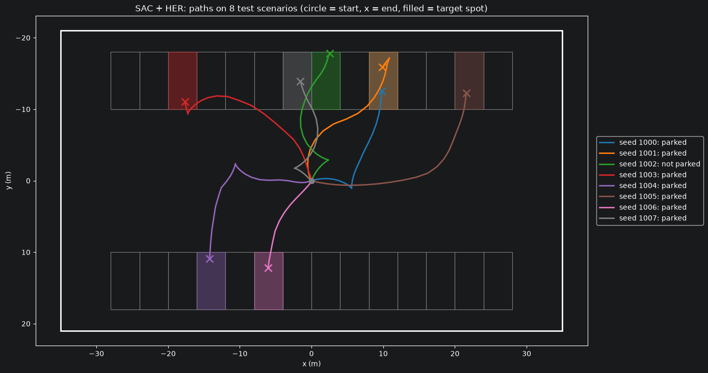
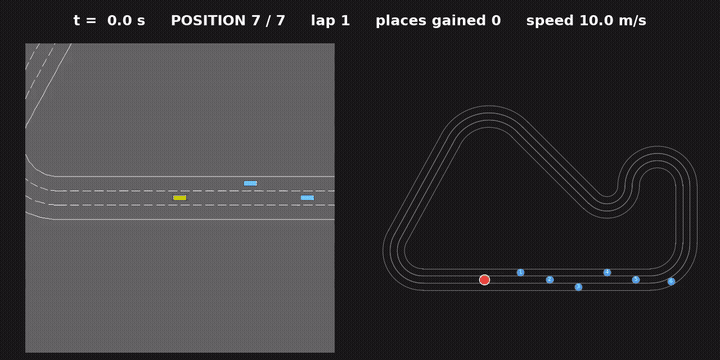

# AutoPilotRL

**Reinforcement learning for self-driving cars, written from scratch in PyTorch: from tabular Q-learning on a highway, to PPO on a race track, to SAC + Hindsight Experience Replay for parking.**

No RL libraries: every algorithm (Q-learning, DQN, Double/Dueling DQN with attention, REINFORCE, PPO, SAC, HER) is implemented step by step in a notebook, on top of the [highway-env](https://github.com/Farama-Foundation/HighwayEnv) simulator, and trained on a laptop CPU.

<p align="center">
  <br>
  <em>The same agent at 12 moments of its training, trying to park in the same spot.<br>Before training it crashes into the wall; after 20,000 steps of practice it parks every time.</em>
</p>

## Results

**Highway** (`highway-fast-v0`, 3 lanes, 20 cars, 30 s; 5 discrete actions once per second; same 50 test scenarios for every driver)

| Driver | Return ↑ | Crash rate ↓ | Mean speed |
|---|---|---|---|
| Random | ≈ 9 | ≈ 97% | – |
| Rule-based (hand-written) | 22.83 | **2%** | 22.5 m/s |
| v2 Tabular Q-learning | 23.05 | 8% | 23.0 m/s |
| v3 DQN | 20.55 | 18% | 21.9 m/s |
| **v4 Double + Dueling DQN with attention** | **26.83** | 10% | **28.5 m/s** |

**Race track** (`racetrack-v0`; continuous steering 5 times per second; a slower car ahead that must be overtaken)

| Driver | Return ↑ (max ≈ 200) | Laps finished ↑ | Crash |
|---|---|---|---|
| Lane keeper (classical controller that reads the lane geometry: it cheats) | 71.3 | 4% | 96% |
| v5 REINFORCE | 97.0 | 62% | 38% |
| **v5 PPO** | **133.4** | **80%** | 16% |

**Parking** (`parking-v0`; throttle + steering; a different target spot in every episode)

| Driver | Parked ↑ | Time | Final distance |
|---|---|---|---|
| Random | 0% | – | 27.8 m |
| v6 SAC | 90% | 6.3 s | 2.14 m |
| **v6 SAC + HER** | **90%** | **5.7 s** | **1.86 m** |

## The journey

Each version fixes the main weakness of the previous one. Every notebook explains each step with the maths, and every line of code is commented.

| Version | Task | Idea | What it fixed | Key concepts |
|---|---|---|---|---|
| [v1](notebooks/autopilot_v1.ipynb) | Highway | Environment and baselines: random, constant and rule-based drivers | — (evaluation harness) | MDP, return, discount, 50 fixed test scenarios, GIF recording |
| [v2](notebooks/autopilot_v2.ipynb) | Highway | Tabular Q-learning on 7 hand-made features (972 situations) | The rule-based driver cannot learn | Bellman equation, TD learning, ε-greedy, optimistic initial values, termination vs truncation |
| [v3](notebooks/autopilot_v3.ipynb) | Highway | DQN on the raw observation (10 vehicles × 5 features) | Hand-made features | Replay buffer, target network, Huber loss, model selection on validation seeds, **measured overestimation** |
| [v4](notebooks/autopilot_v4.ipynb) | Highway | Double DQN + Dueling heads + **ego-attention over vehicles** | Overestimation; an unordered list of cars fed to an MLP | Double DQN, V + A decomposition, attention with masking, **attention maps** |
| [v5](notebooks/autopilot_v5.ipynb) | Race track | REINFORCE, then PPO, with **continuous** steering | DQN needs a max over a finite set of actions | Policy gradient theorem, baselines, Gaussian policy, GAE, clipped objective, bootstrapping at time limits |
| [v6](notebooks/autopilot_v6.ipynb) | Parking | SAC and SAC + **Hindsight Experience Replay** | Goal-conditioned task where success is rare | Maximum-entropy RL, tanh-squashed Gaussian, reparameterisation, twin critics, automatic temperature, Polyak averaging, goal relabelling |
| [Race day](notebooks/autopilot_race.ipynb) | New circuit, 6 opponents | Transfer the v5 driver, fine-tune it, add a safety brake and a racing reward | — (an experiment, see below) | Zero-shot transfer, fine-tuning, **safety shield**, reward shaping |
| [Learning video](notebooks/autopilot_learning_video.ipynb) | Parking | Snapshots of the actor during training, filmed on the same scenario | — | The video at the top of this page |

## Highlights

### 1. The agent learns where to look (v4)
The v4 network treats the surrounding cars as a set: each car is encoded by the same small network, and our car **attends** to them. The attention weights show which car drives each decision. Here the car 15 m ahead takes 85% of the attention, and the agent changes lane to overtake it; seconds later, it watches the car it is passing.



Double DQN almost removes the overestimation of the values, which we measured directly: predicted value at the start of each test episode vs. the discounted return actually obtained. It goes from **+2.49** (v3) to **+0.60**.



<p align="center"><br><em>The v4 driver on test scenario 1000.</em></p>

### 2. Learning to overtake with a steering wheel (v5)
On the race track the agent sees only a 12 × 12 occupancy grid around the car. The classical lane keeper follows the lane perfectly, but is blind to traffic and crashes into the slower car in 96% of the scenarios. PPO learns to keep the lane **and** to overtake:

<table>
<tr>
<td align="center"><br><em>Lane keeper: crash</em></td>
<td align="center"><br><em>PPO: overtakes and finishes</em></td>
</tr>
</table>



With the same experience, PPO beats REINFORCE: it makes 15,360 gradient steps out of 100,000 environment steps, against about a hundred updates for REINFORCE, and the clip keeps each one safe.

### 3. Parking with hindsight (v6)
HER re-uses every failed attempt as a success at reaching *the place where the car actually went*. With it, the agent reaches 50% success after about 15,000 steps instead of 26,000. The agent learned to **reverse** when it starts facing the wrong way, which nobody programmed:



### 4. The recurring lesson: the agent optimises the reward we wrote
- **v4** crashes 5 times as often as the rule-based driver, because the reward pays for speed in every second and a crash only costs the seconds left.
- **v5** steers nervously, because a 3 m grid cannot tell it where it is in a 5 m lane, and the steering penalty is small.
- **v6** often stops at the entrance of the spot, because depth in the spot has a small weight and the episode ends at the first "success".
- **Race day:** with a reward for staying in the lane, following a slow car is a perfectly good strategy.

## Race day: an honest experiment

Can the v5 driver win a race on a circuit it has never seen, starting last behind 6 slower cars?

<p align="center"><br><em>Left: the simulator camera. Right: the whole circuit, our car in red. It gains 4 places, then gets stuck behind a slow car.</em></p>

| Driver (20 races, 90 s, 6 opponents) | Wins | DNF | Places gained |
|---|---|---|---|
| v5 driver as it is | 0% | 100% | 1.2 |
| v5 driver + safety brake | 0% | **30%** | **2.2** |
| Fine-tuned with a racing reward + brake | 0% | 65% | 2.0 |

- **Lane keeping transferred:** 1.6 laps of a new 3-lane circuit with hairpins, without leaving the road.
- **Traffic did not:** without brakes it crashed in every race. A classical **safety brake** (a few lines: slow down if a car is less than 12 m ahead in our path) took retirements from 100% to 30%. This is the *safety shield* idea: a simple, verifiable layer around a learned controller.
- **It never learned to overtake reliably.**
  - Its grid shows where cars are but not how fast they move.
  - It cannot accelerate.
  - An overtake is a long, risky manoeuvre with a delayed reward.
  - 80,000 steps of fine-tuning were not enough to change that.

  The notebook discusses what would be needed: speeds in the observation (as in v4), throttle, a curriculum, and far more training.

## Evaluation
- **Fixed test scenarios** for each task (seeds 1000–1049), never used for training or model selection.
- **Validation** on separate seeds (2000+), training on seeds from 10,000.
- Learned agents are evaluated **deterministically** (greedy action, or the mean of the Gaussian).
- **Termination vs truncation:** a crash ends the future; a time limit does not. Truncated episodes are bootstrapped with the critic's value.
- **Caveats:**
  - one training run per configuration (no seeds averaged), so differences of a few points are within noise;
  - model selection with 10–30 validation episodes is itself noisy, as v4 and the race day show.

## Reproduce

```bash
git clone https://github.com/<your-username>/AutoPilotRL.git
cd AutoPilotRL
python -m venv .venv && source .venv/bin/activate
pip install -r requirements.txt
```

Run the notebooks **in order** from the `notebooks/` folder: v4 loads the v3 network, and Race day loads the v5 driver. Results and trained models are saved in `notebooks/results/` and the videos in `notebooks/videos/` (both ignored by git).

| Notebook | Approximate time on an 8 GB M1 (CPU) |
|---|---|
| v1 | ~3 min |
| v2 | ~10 min |
| v3 | ~10 min |
| v4 | ~25 min |
| v5 | ~30 min |
| v6 | ~15 min |
| Race day | ~45 min |
| Learning video | ~10 min (~2 min when the snapshots already exist) |

The race and learning videos are saved as MP4 if `imageio-ffmpeg` is installed, otherwise as GIF.

## Repository structure
```
AutoPilotRL/
├── notebooks/          autopilot_v1.ipynb … autopilot_v6.ipynb, autopilot_race.ipynb, autopilot_learning_video.ipynb
├── assets/             figures and GIFs for this README
├── requirements.txt
└── README.md
```

## Limitations and next steps
- Small networks and short training runs (30,000–100,000 steps) on a laptop CPU; published results on these environments use far more experience.
- On the highway the best agent is faster but less safe than the rule-based driver: a different reward would trade speed for safety.
- Possible next experiments:
  - the attention network of v4 as the observation encoder for the race track;
  - throttle and steering together for racing;
  - a sparse reward for parking, where HER should make the difference between learning and not learning;
  - several seeds per configuration.

## References
- Leurent, *An Environment for Autonomous Driving Decision-Making* (highway-env), 2018.
- Sutton & Barto, *Reinforcement Learning: An Introduction*, 2nd ed., 2018.
- Mnih et al., *Human-level control through deep reinforcement learning* (DQN), 2015.
- van Hasselt, Guez & Silver, *Deep Reinforcement Learning with Double Q-learning*, 2016.
- Wang et al., *Dueling Network Architectures for Deep Reinforcement Learning*, 2016.
- Leurent & Mercat, *Social Attention for Autonomous Decision-Making in Dense Traffic*, 2019.
- Williams, *Simple Statistical Gradient-Following Algorithms for Connectionist Reinforcement Learning* (REINFORCE), 1992.
- Schulman et al., *High-Dimensional Continuous Control Using Generalized Advantage Estimation*, 2016.
- Schulman et al., *Proximal Policy Optimization Algorithms*, 2017.
- Haarnoja et al., *Soft Actor-Critic: Off-Policy Maximum Entropy Deep Reinforcement Learning with a Stochastic Actor*, 2018, and *Soft Actor-Critic Algorithms and Applications*, 2018.
- Andrychowicz et al., *Hindsight Experience Replay*, 2017.
- Alshiekh et al., *Safe Reinforcement Learning via Shielding*, 2018.
